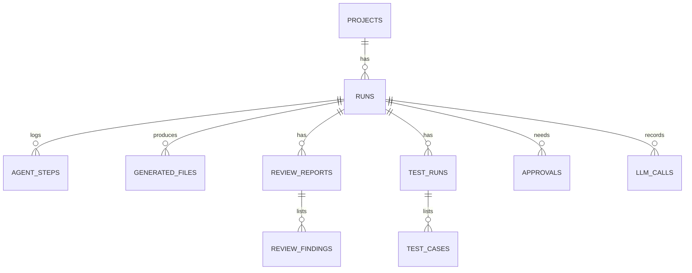

# Database Schema

> Status: built in Phase 7: models in `backend/app/db/models.py`, migration
> `backend/migrations/versions/0001_initial_schema.py`, applied at API startup. A test checks
> that the migrations match the models.

## Choices

- **SQLite** via **SQLAlchemy 2.0**, migrations with **Alembic** ([ADR 0006](adr/0006-sqlite-and-alembic.md)).
- Two separate files in `data/`: `devteam.db` (application data) and `checkpoints.db`
  (LangGraph's own checkpoint tables). They have different owners and lifecycles.
- Generated source files stay on disk in `workspaces/<project_id>/`. The database stores only
  metadata (path, SHA-256, size, version), not file contents.

## ER diagram

## Tables

| Table | Columns | Notes |
|---|---|---|
| `projects` | `id` PK, `name`, `requirement`, `created_at` | one project, many runs (as built: the workspace belongs to each run, so `workspace_path` moved to `runs.workspace`) |
| `runs` | `id` PK, `project_id` FK, `status`, `review_status`, `test_status`, `review_rounds`, `fix_rounds`, `thread_id`, `error`, `started_at`, `finished_at` | `thread_id` links to the LangGraph checkpoint |
| `agent_steps` | `id` PK, `run_id` FK, `agent`, `round`, `status`, `summary`, `started_at`, `finished_at` | progress timeline |
| `generated_files` | `id` PK, `run_id` FK, `path`, `sha256`, `size_bytes`, `version` | metadata only |
| `review_reports` | `id` PK, `run_id` FK, `round`, `verdict` | one per review round |
| `review_findings` | `id` PK, `report_id` FK, `file`, `line`, `severity`, `category`, `message`, `suggested_fix` | |
| `test_runs` | `id` PK, `run_id` FK, `round`, `executor`, `passed`, `failed`, `errors`, `duration_ms`, `triage` | `triage` is JSON |
| `test_cases` | `id` PK, `test_run_id` FK, `name`, `outcome`, `message` | |
| `approvals` | `id` PK, `run_id` FK, `kind` (`clarify` / `execute` / `commit`), `status`, `answer`, `token_hash`, `created_at`, `decided_at` | only a hash of the commit token is stored |
| `llm_calls` | `id` PK, `run_id` FK, `agent`, `model`, `input_tokens`, `output_tokens`, `latency_ms`, `created_at` | cost and usage tracking |

As built, `runs` also stores `current_step`, `workspace`, `model`, `llm_calls`,
`input_tokens`, `output_tokens` and `commit_sha`; `review_findings` stores `source` and `rule`;
`test_runs` stores `status`, `skipped` and `detail`; `approvals.payload` holds what the human is
shown (questions, files, commit message). Ids: `prj_…`, `apr_…`; run ids are the LangGraph thread
ids (`YYYYMMDD-HHMMSS-xxxx`).

The tables are a queryable copy of each run's state, written after every node by
`backend/app/services/sync.py`. Each sync step only adds what is missing, so it can run
repeatedly. File contents stay on disk; `generated_files` adds a new version row only when a
file's SHA-256 changes. SQLite runs with foreign keys on and WAL journaling.

## Indexes

Every foreign key column, plus `runs.status` and `approvals.status` (listing pending approvals).

## Concepts covered when this is built

Primary and foreign keys, one-to-many relationships, normalisation (findings and test cases in
their own tables rather than JSON blobs), transactions (a review report and its findings are
written together), Alembic migrations and schema evolution.

## When to move to PostgreSQL

Multiple users, concurrent runs writing at once, more than one backend instance, or a need for
managed backups. SQLAlchemy keeps the migration mostly to a connection-string change.
