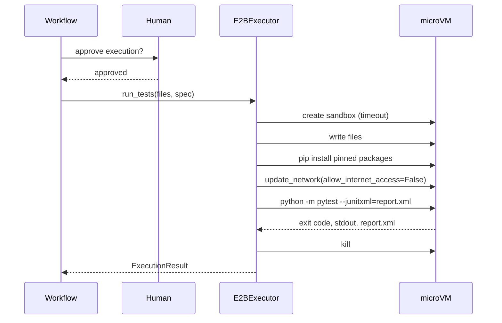

# Execution Sandbox

> Status: built in Phase 4 (`backend/app/execution/`). Verified live against E2B.

## Rule

Generated code is **never executed on the host machine**. Docker is not available on the
development machine (no virtualization), and restricted local execution is not real isolation.
See [ADR 0005](adr/0005-remote-microvm-sandbox.md).

## Design

```python
class CodeExecutor(Protocol):
    def run_tests(self, files: list[WorkspaceFile], spec: ExecutionSpec) -> ExecutionResult: ...
```

| Executor | Selected by | Behaviour | Test status |
|---|---|---|---|
| `E2BExecutor` | `EXECUTOR=e2b` and `E2B_API_KEY` set | Fresh E2B microVM per run: upload files, install pinned packages, switch internet off, run pytest with JUnit XML, download results, kill the sandbox | `PASSED` / `FAILED` |
| `StaticOnlyExecutor` | `EXECUTOR=static_only` or no key | Runs `ast`, `ruff`, `bandit` on the host; these only parse code and never import or run it | `NOT_EXECUTED` |



## As built (Phase 4)

- `base.py`: `CodeExecutor` protocol, `ExecutionSpec`, `ExecutionResult` (status, counts,
  per-test cases with messages, `detail` for errors, output tail). `run_tests` never raises for
  problems inside the run; it reports `ERROR` with a reason.
- `e2b_executor.py`: the sequence above. Paths are validated before a sandbox is created; the
  sandbox gets no environment variables; install uses `-c constraints.txt`; internet is switched
  off before pytest; the sandbox is killed in `finally`. Exit code 5 (no tests) and collection
  errors become a synthetic failing case, so triage always has something to read.
- `junit.py`: parses the JUnit report with `defusedxml` and a 2 MB size limit (the report comes
  from untrusted code). Collection errors are named `tests/test_x.py::(collection)`.
- `static_only.py`: never runs anything; checks test files parse and returns `NOT_EXECUTED`.
- `factory.py`: `EXECUTOR=e2b` with a key → E2B; otherwise static-only with the reason.
- `packages.py` + `constraints.txt`: the allow-list (fastapi, uvicorn, pydantic,
  pydantic-settings, email-validator, python-multipart, sqlalchemy, pyjwt, python-jose, passlib,
  bcrypt, httpx; pytest and httpx always) and 40 pins for every package including transitive
  ones. `requirements.txt` version specifiers are ignored and unknown names are refused (never
  installed). Generated inside an E2B sandbox by `backend/scripts/lock_sandbox_packages.py`, so
  the pins match its Python 3.11.6. `bcrypt` is held at 4.0.1 because passlib 1.7.4 fails with
  newer versions.

Live check (2026-11-19): a known app plus four tests, one wrong on purpose and one opening a
socket to `pypi.org`, took 30 s in total. Results: 3 passed; the wrong test failed with its
assertion message; the socket test passed because the connection was refused (internet off).

## Phase 0 spike result (Spike A)

A two-file FastAPI app with two tests was run in E2B using SDK `e2b` 2.64:

| Step | Result |
|---|---|
| Create sandbox | 3.2 s |
| `pip install fastapi httpx pytest` (pinned) | exit 0, 10.5 s |
| `update_network({"allow_internet_access": False})` on the running sandbox | worked |
| `pytest --junitxml` | 2 passed, report downloaded |
| Test inside the sandbox opening a socket to `pypi.org` | blocked |
| `curl https://pypi.org` after the switch | blocked |
| Total including kill | 42.3 s |

Findings:

- Install-then-cut-internet works with no custom template and no local Docker.
- The sandbox's Python is 3.11, so generated projects target Python 3.11.
- Pinning only top-level packages still pulls newer transitive packages (a deprecation warning
  appeared from `anyio`); Phase 4 uses a full constraints file.
- Blocked network calls wait for their timeout, so tests must not depend on the network and
  the executor uses a per-run timeout.

## Controls

- New sandbox per run; always killed in a `finally` block; sandbox-side timeout as a backstop.
- `SANDBOX_TIMEOUT_SECONDS` per run; output size limits for stdout, stderr and reports.
- Packages only from a pinned allow-list (constraints file).
- Internet off before any generated code runs.
- No secrets enter the sandbox: no `envs` are passed; the LLM and E2B keys stay in the backend.
- Only the project's generated files are uploaded.

## Limitations

- Generated code (not secrets) is sent to a third-party provider.
- Package installation happens with internet on, before generated code runs; a malicious
  package on the allow-list could still act during install. The allow-list is small and pinned.
- Depends on E2B availability and quotas; `StaticOnlyExecutor` is the fallback.
