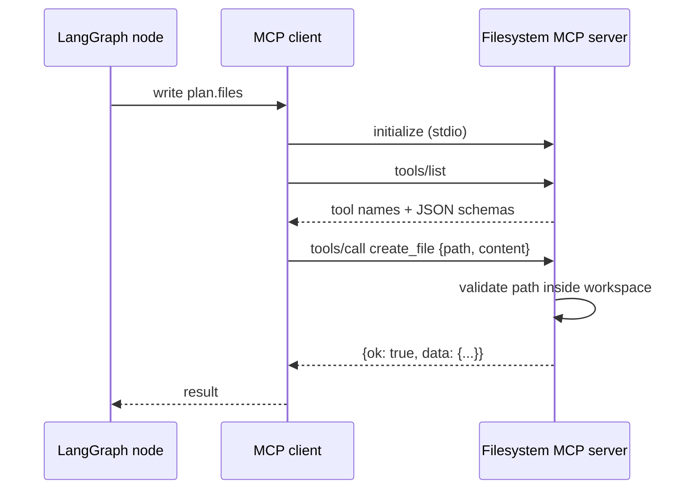

# MCP Architecture

> Status: designed in Phase 0, built in Phase 2 (Filesystem) and Phase 6 (Git).

## LangGraph vs MCP

- **LangGraph** decides *what runs when*: state, routing, loops, human pauses.
- **MCP (Model Context Protocol)** defines *how tools are exposed and called*: a client discovers a
  server's tools, reads their JSON schemas, and invokes them over a transport.

They are complementary. A LangGraph node uses an MCP client to call a tool on an MCP server.
MCP is not an agent framework and not an orchestrator.

## Transport and lifecycle

- Both servers are built with the official Python MCP SDK (FastMCP) and run over **stdio** as
  child processes of the backend. See [ADR 0003](adr/0003-own-mcp-servers-over-stdio.md).
- The backend starts them in the FastAPI lifespan and stops them on shutdown; a crashed server
  is restarted and the call retried once.
- Servers receive only the variables they need (the workspaces root), not the whole environment.

## Filesystem MCP server

Tools: `create_file`, `read_file`, `list_files`, `update_file`.

Rules:

- Every path is resolved to a real absolute path and must be inside the project workspace.
- Rejected: `..` escapes, absolute paths, drive letters, UNC paths (`\\server\share`), Windows
  reserved names (`CON`, `NUL`, `COM1` …), symlinks leaving the workspace, null bytes.
- Size limit per file and an allowed-extension list (`.py`, `.txt`, `.md`, `.toml`, `.cfg`,
  `.ini`, `.json`, `.yaml`).
- Every result has one shape: `{ok, data}` or `{ok: false, error_code, message}`.

## Git MCP server

Tools: `initialize_repository`, `get_git_status`, `create_commit`, `get_commit_history`.

Rules:

- `git` is run with a fixed argument list, never through a shell, with no user-controlled flags.
- Repository path must be a validated workspace.
- `create_commit` requires a one-time **approval token** issued by the backend when the human
  approves; the server refuses commits without a valid token (defence in depth).
- No push or remote operations in v1.

## Who may call which tool

| Tool | Workflow code | LLM (agent) |
|---|---|---|
| `read_file`, `list_files`, `get_git_status`, `get_commit_history` | yes | yes |
| `create_file`, `update_file` | yes | no |
| `initialize_repository`, `create_commit` | yes | no |

See [ADR 0004](adr/0004-deterministic-tool-calls-for-writes.md).
