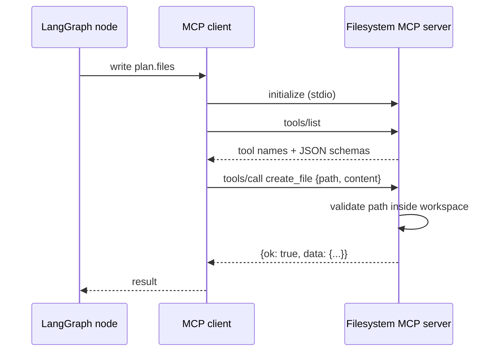

# MCP Architecture

> Status: Filesystem server built in Phase 2. Git server planned for Phase 6.

## LangGraph vs MCP

- **LangGraph** decides *what runs when*: state, routing, loops, human pauses.
- **MCP (Model Context Protocol)** defines *how tools are exposed and called*: a client discovers a
  server's tools, reads their JSON schemas, and invokes them over a transport.

They are complementary. A LangGraph node uses an MCP client to call a tool on an MCP server.
MCP is not an agent framework and not an orchestrator.

## Transport and lifecycle

- Both servers are built with the official Python MCP SDK (`MCPServer`, called `FastMCP`
  before SDK 2.0) and run over **stdio** as
  child processes of the backend. See [ADR 0003](adr/0003-own-mcp-servers-over-stdio.md).
- The backend starts them in the FastAPI lifespan and stops them on shutdown; a crashed server
  is restarted and the call retried once.
- Servers receive only the variables they need (the workspaces root), not the whole environment.

## Filesystem MCP server

Code: `backend/app/workspace/` (rules and file operations, no MCP),
`backend/app/mcp_servers/filesystem/` (server), `backend/app/mcp_clients/filesystem.py` (client).

Tools (every one takes `workspace`, the folder name under `WORKSPACES_DIR`):

| Tool | Arguments | Data on success | Annotation |
|---|---|---|---|
| `create_file` | workspace, path, content | path, size_bytes | writes; refuses to overwrite |
| `read_file` | workspace, path | path, content, size_bytes | read-only |
| `list_files` | workspace | files: [{path, size_bytes}] | read-only |
| `update_file` | workspace, path, content | path, size_bytes | writes; file must exist |

The server reads no `.env`. The client passes only `DEVTEAM_WORKSPACES_DIR` and optional limits,
so API keys never reach the server process. `python -m app.cli fs-demo` starts it and shows the
tools and some refused paths.

Error codes: `INVALID_PATH`, `INVALID_WORKSPACE`, `EXTENSION_NOT_ALLOWED`, `PATH_ESCAPE`,
`WORKSPACE_NOT_FOUND`, `FILE_EXISTS`, `FILE_NOT_FOUND`, `NOT_A_FILE`, `NOT_TEXT`,
`FILE_TOO_LARGE`, `WORKSPACE_FULL`, `INVALID_CONTENT`, `IO_ERROR`, `INTERNAL_ERROR`.
Messages never contain absolute host paths, because they can reach the LLM.

Two checks, in order:

1. **String rules** (`paths.py`), before touching the disk. The same function validates the
   Planner's output, so any valid plan can be written.
2. **Containment** (`store.py`): the real path, after following symlinks and Windows junctions,
   must be inside the workspace folder. This catches links that string rules cannot see.

Limits: 100 KB per file, 50 files per workspace (configurable). `create_file` opens in
create-only mode; `update_file` writes a temporary file and swaps it in, so a crash never leaves
half a file. `list_files` skips hidden entries (such as `.git`) and links.

Rules:

- Every path is resolved to a real absolute path and must be inside the project workspace.
- Rejected: hidden files and folders, trailing dots or spaces, NTFS streams (`a.py:x`),
  `..` escapes, absolute paths, drive letters, UNC paths (`\\server\share`), Windows
  reserved names (`CON`, `NUL`, `COM1` …), symlinks leaving the workspace, null bytes.
- Size limit per file and an allowed-extension list (`.py`, `.txt`, `.md`, `.toml`, `.cfg`,
  `.ini`, `.json`, `.yaml`).
- Every result has one shape: `{ok, data}` or `{ok: false, error_code, message}`.
- Planned for Phase 7: the FastAPI lifespan owns the connection, restarts a crashed server and
  retries the call once. Until then each caller opens a connection with `async with`.

## Git MCP server

Tools: `initialize_repository`, `get_git_status`, `create_commit`, `get_commit_history`.

Rules:

- `git` is run with a fixed argument list, never through a shell, with no user-controlled flags.
- Repository path must be a validated workspace.
- `create_commit` requires a one-time **approval token** issued by the backend when the human
  approves; the server refuses commits without a valid token (defence in depth).
- No push or remote operations in v1.

## Who may call which tool

| Tool | Workflow code | LLM (agent) |
|---|---|---|
| `read_file`, `list_files`, `get_git_status`, `get_commit_history` | yes | yes |
| `create_file`, `update_file` | yes | no |
| `initialize_repository`, `create_commit` | yes | no |

See [ADR 0004](adr/0004-deterministic-tool-calls-for-writes.md).

Enforced in code, not only by prompt: workflow code holds a `FilesystemClient`; an agent gets
`client.read_only()`, a `ReadOnlyFilesystem` that has no write methods, lists only the read
tools, and rejects any other tool name before sending anything.
