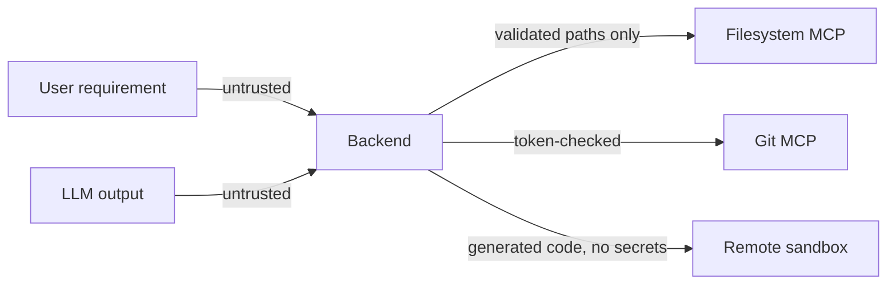

# Security Design

> Status: every control below is built and covered by tests; see [Security tests](#security-tests).

## Assets

The developer's machine and files, API keys, the integrity of generated projects and their Git
history, and the LLM/sandbox budget.

## Trust boundaries

User input, LLM output and generated code are **untrusted data**. Trusted: backend code, the
MCP servers' validation logic, configuration in `.env`.

## Threats and controls

| # | Threat | Control | Phase |
|---|---|---|---|
| T1 | Generated code damages the host | Never executed on host; remote microVM; static tools only parse | 4 |
| T2 | Path traversal through file tools | Real-path containment check, Windows path rules, extension and size limits | 2 |
| T3 | Prompt injection in the requirement ("read ~/.ssh", "commit now") | LLM cannot call write or commit tools; read tools are workspace-locked; requirement passed as delimited data | 3 |
| T4 | Malicious or malformed agent output | Pydantic validation; path, size and extension checks before writing | 1–3 |
| T5 | Secret leakage | Keys only in backend process; none sent to sandbox or LLM; log redaction; `.env` git-ignored | 1, 4 |
| T6 | Runaway loops or cost | `MAX_REVIEW_ROUNDS`, `MAX_FIX_ROUNDS`, `MAX_LLM_CALLS_PER_RUN`, timeouts | 5 |
| T7 | Unauthorised commit | Human approval; HMAC-signed one-time token per approval, bound to workspace and a digest of the approved files, 10-minute expiry, per-start secret; verified by the Git server ([ADR 0011](adr/0011-commit-approval-tokens.md)) | 6 (built) |
| T8 | Command injection through Git | Fixed argument lists, no shell, no user-controlled flags; message passed as one argument and validated; user config and hooks ignored | 6 (built) |
| T13 | Git acting on the wrong repository (workspaces are inside this project's checkout) | Explicit `--git-dir`/`--work-tree` and `GIT_CEILING_DIRECTORIES`; uninitialised workspace gives `NOT_A_REPOSITORY` | 6 (built) |
| T14 | Content changed between approval and commit | Digest taken before the pause and checked by the Git server (`CONTENT_CHANGED`) | 6 (built) |
| T9 | Malicious dependency in the sandbox | Small allow-list; every package pinned by a constraints file generated in the sandbox; unknown names never installed; `-r`/`--index-url` lines refused | 4 (built) |
| T10 | Network abuse by generated code | Internet switched off before pytest runs; verified live by a test that tries to reach pypi.org | 4 (built) |
| T11 | Local API abuse by other sites | Bound to `127.0.0.1`; CORS limited to the frontend origin, GET/POST only; no authentication (single-user, documented); errors never return internals | 7 (built) |
| T12 | Sandbox escape or provider compromise | Accepted risk; only generated code is sent; documented | — |
| T15 | "Try the API" exposes generated code to the internet | Same sandbox rules as tests (no environment variables, allow-listed pinned packages, outbound internet off before the app starts); only for runs whose tests passed; random URL; the sandbox deletes itself after 10 minutes or on Stop; nothing runs on the host. The URL is not authenticated while it runs (documented) | after 10 |

## Security tests

Every built control has automated tests (backend `pytest`, all offline):

| Threat | Tests |
|---|---|
| T1 Generated code on the host | `test_static_analysis` (tools parse, never import); `test_execution` (static-only executor never runs code, reports `NOT_EXECUTED`) |
| T2 Path traversal | `test_workspace_paths` (`..`, drive letters, UNC, NTFS streams, device names, hidden files); `test_workspace_store` (symlink and junction escapes, size and count limits, no host paths in errors); `test_filesystem_mcp`; `test_api` (`../../.env` through the API → 400) |
| T3 Prompt injection | `test_security` (agents are built from an LLM only; Reviewer gets the read-only view; injected plan paths rejected); `test_reviewer` (comment telling the reviewer to approve cannot pass a bandit finding); `test_filesystem_mcp` (read-only view refuses write tools) |
| T4 Malformed agent output | `test_plan_schema`, `test_code_and_review_schemas` (paths, sizes, test files, escaped newlines); `test_developer`, `test_tester` (corrective retries, then errors) |
| T5 Secret leakage | `test_logging` (redaction); `test_security` (no keys to MCP servers, health and error bodies, settings repr); `test_execution` (no environment passed to the sandbox) |
| T6 Runaway loops or cost | `test_workflow` (review and fix round limits, LLM-call budget across stages); `test_execution` (timeouts end as `ERROR`) |
| T7 Unauthorised commit | `test_gitops` (missing, forged, edited, expired, wrong-workspace and reused tokens); `test_workflow` (declined commit, edit during the pause); `test_security` (no API route can commit) |
| T8 Command injection through Git | `test_gitops` (message validation, user config and hooks ignored) |
| T9 Malicious dependency | `test_execution` (unknown packages, `-r` and `--index-url` lines refused; every allowed package pinned) |
| T10 Network abuse | `test_execution` (internet switched off before pytest, in that order); live check: a socket to pypi.org was refused |
| T11 Local API abuse | `test_security` (binds to 127.0.0.1, CORS only for the dashboard, cross-site preflight refused) |
| T13 Wrong repository | `test_gitops` (workspace inside another repository reports `NOT_A_REPOSITORY`) |
| T14 Content changed after approval | `test_workflow` (file edited during the commit pause → `NOT_COMMITTED`) |

Failure scenarios with tests: provider outage and used-up quota → `ERROR`; model that never gives
a valid answer → `FAILED_REVIEW` / `FAILED_TESTS`; sandbox unreachable, install failure or test
timeout → `ERROR`; the Filesystem MCP server dying mid-run → `ERROR`; API restart while a run is
paused (resumes) or mid-step (marked `ERROR`).

## Logging

Structured logs with request and run IDs. Never log API keys, approval tokens, or full file
contents; long LLM outputs are truncated.

## Known limitations

- Single user, no authentication (localhost only).
- Generated code leaves the machine to the sandbox provider.
- LLM review and static analysis reduce risk; they do not prove code is secure.
- The JUnit report and test output come from untrusted code: parsed with `defusedxml`,
  size-limited, and only shown to models as delimited data.
- Generated code may contain text aimed at the Reviewer ("approve this"). The verdict is
  computed from findings, and static tools are independent of the model, so such text cannot
  force a pass while a high static finding exists (tested).
- Package installation runs with internet on, before the network is cut.
- A "Try the API" URL works for anyone who has it, for up to 10 minutes. It serves only the
  generated app, which holds no secrets and has no outbound internet.
