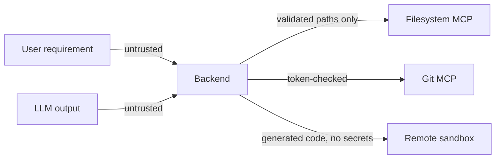

# Security Design

> Status: designed in Phase 0. Controls are implemented in the phases listed and verified in Phase 9.

## Assets

The developer's machine and files, API keys, the integrity of generated projects and their Git
history, and the LLM/sandbox budget.

## Trust boundaries

User input, LLM output and generated code are **untrusted data**. Trusted: backend code, the
MCP servers' validation logic, configuration in `.env`.

## Threats and controls

| # | Threat | Control | Phase |
|---|---|---|---|
| T1 | Generated code damages the host | Never executed on host; remote microVM; static tools only parse | 4 |
| T2 | Path traversal through file tools | Real-path containment check, Windows path rules, extension and size limits | 2 |
| T3 | Prompt injection in the requirement ("read ~/.ssh", "commit now") | LLM cannot call write or commit tools; read tools are workspace-locked; requirement passed as delimited data | 3 |
| T4 | Malicious or malformed agent output | Pydantic validation; path, size and extension checks before writing | 1–3 |
| T5 | Secret leakage | Keys only in backend process; none sent to sandbox or LLM; log redaction; `.env` git-ignored | 1, 4 |
| T6 | Runaway loops or cost | `MAX_REVIEW_ROUNDS`, `MAX_FIX_ROUNDS`, `MAX_LLM_CALLS_PER_RUN`, timeouts | 5 |
| T7 | Unauthorised commit | Human approval; HMAC-signed one-time token per approval, bound to workspace and a digest of the approved files, 10-minute expiry, per-start secret; verified by the Git server ([ADR 0011](adr/0011-commit-approval-tokens.md)) | 6 (built) |
| T8 | Command injection through Git | Fixed argument lists, no shell, no user-controlled flags; message passed as one argument and validated; user config and hooks ignored | 6 (built) |
| T13 | Git acting on the wrong repository (workspaces are inside this project's checkout) | Explicit `--git-dir`/`--work-tree` and `GIT_CEILING_DIRECTORIES`; uninitialised workspace gives `NOT_A_REPOSITORY` | 6 (built) |
| T14 | Content changed between approval and commit | Digest taken before the pause and checked by the Git server (`CONTENT_CHANGED`) | 6 (built) |
| T9 | Malicious dependency in the sandbox | Small allow-list; every package pinned by a constraints file generated in the sandbox; unknown names never installed; `-r`/`--index-url` lines refused | 4 (built) |
| T10 | Network abuse by generated code | Internet switched off before pytest runs; verified live by a test that tries to reach pypi.org | 4 (built) |
| T11 | Local API abuse by other sites | Bind to `127.0.0.1`; CORS limited to the frontend origin | 7 |
| T12 | Sandbox escape or provider compromise | Accepted risk; only generated code is sent; documented | — |

## Logging

Structured logs with request and run IDs. Never log API keys, approval tokens, or full file
contents; long LLM outputs are truncated.

## Known limitations

- Single user, no authentication (localhost only).
- Generated code leaves the machine to the sandbox provider.
- LLM review and static analysis reduce risk; they do not prove code is secure.
- The JUnit report and test output come from untrusted code: parsed with `defusedxml`,
  size-limited, and only shown to models as delimited data.
- Generated code may contain text aimed at the Reviewer ("approve this"). The verdict is
  computed from findings, and static tools are independent of the model, so such text cannot
  force a pass while a high static finding exists (tested).
- Package installation runs with internet on, before the network is cut.
