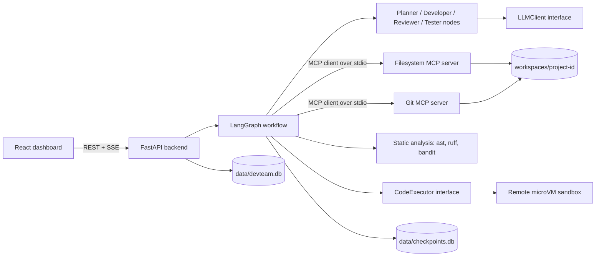
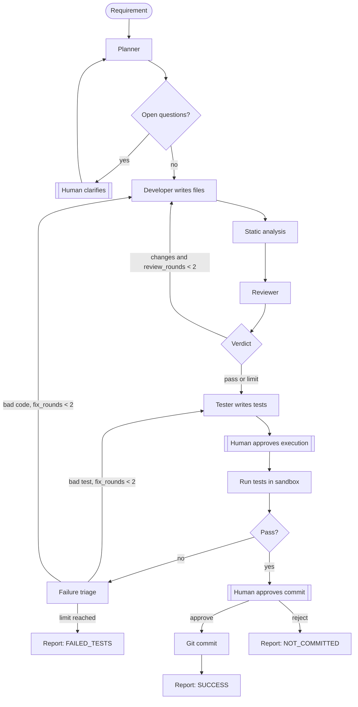
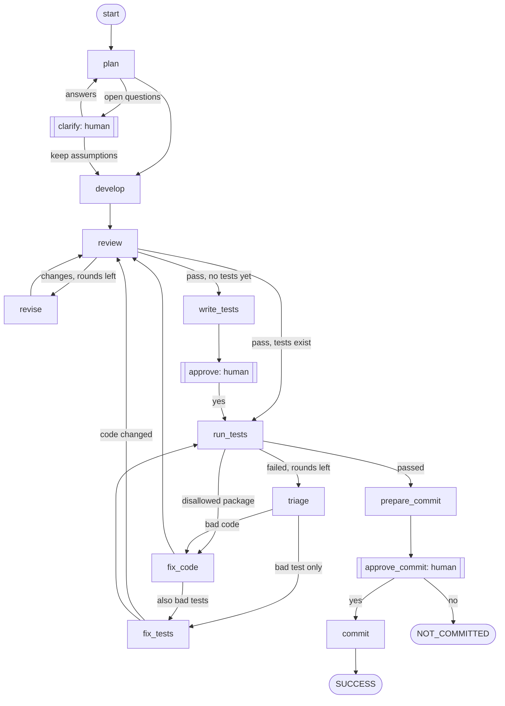

# System Architecture

> Status: designed in Phase 0. Agents, MCP filesystem, sandbox and the LangGraph workflow
> are built (Phases 1–5); Git (6), API and database (7) and the React dashboard (8).

## Style

A **modular monolith**: one FastAPI process bound to `127.0.0.1` hosts the API, the LangGraph
workflow and the MCP clients. The two MCP servers run as child processes over stdio. Generated
code is executed only in a remote microVM sandbox. See [ADR 0001](adr/0001-modular-monolith.md).

## Components

| Component | Responsibility | Folder (planned) |
|---|---|---|
| API | HTTP endpoints, SSE progress, approvals | `backend/app/api` |
| Workflow | State, routing, loop limits, human pauses | `backend/app/graph` |
| Agents | One LLM role each, validated output | `backend/app/agents` |
| LLM client | Provider-agnostic calls, usage logging | `backend/app/llm` |
| MCP clients | Connect to and call the MCP servers | `backend/app/mcp_clients` |
| MCP servers | Workspace file tools, Git tools | `mcp_servers/` |
| Static analysis | Parse, lint and security-scan without executing | `backend/app/analysis` |
| Executor | Run tests in the sandbox or skip safely | `backend/app/execution` |
| Persistence | SQLAlchemy models, Alembic migrations | `backend/app/db`, `backend/alembic` |
| Frontend | Dashboard | `frontend/` |

## Workflow

Rules:

- Separate counters `review_rounds` and `fix_rounds`, each at most 2, plus `MAX_LLM_CALLS_PER_RUN`.
- Review status and test status are separate fields; a passed review never implies passed tests.
- Human pauses use LangGraph `interrupt()` with a SQLite checkpointer so a run can resume later.
- Terminal states: `SUCCESS`, `FAILED_REVIEW`, `FAILED_TESTS`, `NOT_EXECUTED`, `NOT_COMMITTED`,
  `ERROR`, `CANCELLED`.

### As built (Phase 5)

Code: `backend/app/workflow/` (`state.py`, `nodes.py`, `graph.py`, `workspace_io.py`).

Every node also has an edge to the end: a terminal status (`NOT_COMMITTED`, `FAILED_REVIEW`,
`FAILED_TESTS`, `NOT_EXECUTED`, `ERROR`, `CANCELLED`) set by a node, a limit or a human answer ends the run.

- **State vs dependencies.** `RunState` is plain data (plan, counters, review reports, test
  rounds, token totals) and is checkpointed to SQLite (`CHECKPOINT_DB_PATH`) after every node.
  Live objects (LLM client, MCP connection, executor, limits) are passed as LangGraph's runtime
  context (`WorkflowDeps`) on every start and resume, so they are never stored.
- **Pauses.** `clarify`, `approve` and `approve_commit` call `interrupt()`. The run stops, the checkpoint keeps
  it, and any later process can resume it with `Command(resume=...)`. Both pauses accept
  `cancel` (→ `CANCELLED`). Nodes that pause do nothing before `interrupt()`, because a resumed
  node runs again from its first line.
- **Defined endings.** A `guard` around each working node turns failures into statuses: a
  model that cannot give a usable answer → `FAILED_REVIEW` or `FAILED_TESTS` (by stage), provider
  outage, LLM-call limit or workspace error → `ERROR`. Routers send any terminal status to END.
- **Run ids** are `YYYYMMDD-HHMMSS-xxxx` and are the LangGraph thread ids.
- **Commit (Phase 6).** `prepare_commit` stores the digest of the files and the proposed
  message in the checkpoint, `approve_commit` pauses, `commit` initialises the repository and
  commits with a one-time token. Git refusals end the run as `NOT_COMMITTED`.

## Backend ↔ frontend

The frontend starts runs and sends approvals over REST, and receives progress over Server-Sent
Events (`GET /api/runs/{id}/events`). See [API_DESIGN](API_DESIGN.md) and
[ADR 0008](adr/0008-sse-for-progress.md).

### Dashboard (Phase 8)

Code: `frontend/` (React 19, TypeScript 7, Vite 8, React Router 7, plain CSS).

| Screen | Route | Shows |
|---|---|---|
| Projects | `/` | New project form (name, requirement, type fixed to FastAPI) that creates the project and starts a run; projects with their latest runs |
| Run: Live | `/runs/:id` | Four agent cards (state, steps, latest line), counters, approval panel (clarify / execute / commit), live event feed, cancel |
| Run: Workspace | `/runs/:id/workspace` | File tree with finding counts, code viewer with line numbers and flagged lines, findings per file, git status and history |
| Run: Report | `/runs/:id/report` | Verdict; review status and test status shown separately; test cases; triage; latest review; LLM usage per agent; steps |

- `RunLayout` holds one event stream and one copy of the run for all three run tabs.
- `useRunEvents` wraps `EventSource`: it de-duplicates replayed events by id and closes the
  stream after `finished` (otherwise the browser would reconnect and replay).
- `api/client.ts` is a typed client; every API error becomes an `ApiError` with the API's code.
- The frontend reads the root `.env` (`envDir: ".."`); only `VITE_API_BASE_URL` is used.

## Configuration

One `.env` at the repo root serves backend, MCP servers and frontend
([ADR 0010](adr/0010-single-root-env.md)). Template: `.env.example`.
