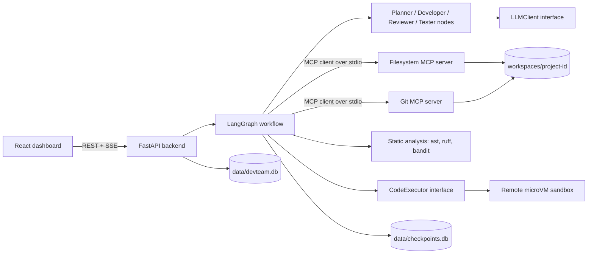

# System Architecture

> Status: designed in Phase 0, not yet implemented.

## Style

A **modular monolith**: one FastAPI process bound to `127.0.0.1` hosts the API, the LangGraph
workflow and the MCP clients. The two MCP servers run as child processes over stdio. Generated
code is executed only in a remote microVM sandbox. See [ADR 0001](adr/0001-modular-monolith.md).

## Components

| Component | Responsibility | Folder (planned) |
|---|---|---|
| API | HTTP endpoints, SSE progress, approvals | `backend/app/api` |
| Workflow | State, routing, loop limits, human pauses | `backend/app/graph` |
| Agents | One LLM role each, validated output | `backend/app/agents` |
| LLM client | Provider-agnostic calls, usage logging | `backend/app/llm` |
| MCP clients | Connect to and call the MCP servers | `backend/app/mcp_clients` |
| MCP servers | Workspace file tools, Git tools | `mcp_servers/` |
| Static analysis | Parse, lint and security-scan without executing | `backend/app/analysis` |
| Executor | Run tests in the sandbox or skip safely | `backend/app/execution` |
| Persistence | SQLAlchemy models, Alembic migrations | `backend/app/db`, `backend/alembic` |
| Frontend | Dashboard | `frontend/` |

## Workflow

Rules:

- Separate counters `review_rounds` and `fix_rounds`, each at most 2, plus `MAX_LLM_CALLS_PER_RUN`.
- Review status and test status are separate fields; a passed review never implies passed tests.
- Human pauses use LangGraph `interrupt()` with a SQLite checkpointer so a run can resume later.
- Terminal states: `SUCCESS`, `FAILED_REVIEW`, `FAILED_TESTS`, `NOT_EXECUTED`, `NOT_COMMITTED`,
  `ERROR`, `CANCELLED`.

## Backend ↔ frontend

The frontend starts runs and sends approvals over REST, and receives progress over Server-Sent
Events (`GET /api/runs/{id}/events`). See [API_DESIGN](API_DESIGN.md) and
[ADR 0008](adr/0008-sse-for-progress.md).

## Configuration

One `.env` at the repo root serves backend, MCP servers and frontend
([ADR 0010](adr/0010-single-root-env.md)). Template: `.env.example`.
